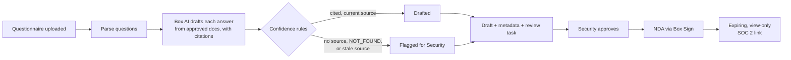

# Security Questionnaire Agent

An AI agent that turns a prospect's vendor security questionnaire into a sourced, reviewed draft in under a minute, and only asks a human about the answers it can't back up.

Built in Python on the [Box AI API](https://developer.box.com/guides/box-ai/). All sample content is fictional.

## The problem

Before a bank or hospital buys software, its security team sends the vendor a questionnaire of 50 to 300 questions ("Where is our data stored?", "How fast do you report a breach?"). The deal waits until every answer is in. Sales engineers hunt through old spreadsheets and wiki pages, chase the Security team for anything they can't find, and email confidential audit reports with no control over who sees them. Each questionnaire costs days.

## What the agent does

1. **Picks up the questionnaire.** A webhook (or a polling loop) fires when a sales engineer drops the `.xlsx` into a deal's `Security Review` folder.
2. **Parses the questions deterministically.** A spreadsheet parser, not an LLM, finds the header row and every question, so nothing is skipped or invented.
3. **Drafts each answer from approved content only.** It asks Box AI, in parallel, to answer from the Security team's approved documents and to cite the source file. If the documents don't answer the question, the model must reply `NOT_FOUND`.
4. **Flags weak answers instead of guessing.** Auditable confidence rules mark an answer low-confidence if it has no citation, came back `NOT_FOUND`, or cites a document past its review date.
5. **Writes a draft for review.** A copy of the questionnaire gets Response, Source, Confidence and Reviewer note columns, with flagged rows highlighted.
6. **Makes status visible.** Deal metadata (account, status, % auto-answered, flagged count, due date) lets sales leadership track every review without a separate tracker.
7. **Hands off to Security.** A review task lists only the flagged questions.
8. **Releases sensitive documents safely.** When Security approves, the prospect gets an NDA through Box Sign. Once it's signed, the SOC 2 report goes out as a view-only link that expires.



## Results on the sample questionnaire

On a 25-question sample questionnaire, the agent drafted **18 answers in about 23 seconds**, each citing its source document, and **flagged the other 7** for review: 5 the approved documents don't cover, plus 2 that cite an out-of-date continuity policy.

## Design choices

- **Deterministic where it matters.** Parsing and confidence scoring are plain code, so a reviewer can see exactly why an answer was flagged. The LLM only writes the answer text.
- **Human in the loop.** Nothing reaches a customer without Security's approval, and reviewers only look at the answers that need them.
- **Least privilege.** The agent runs as a service account with access to two folders and nothing else.
- **Content stays governed.** Box AI answers only from documents the agent is allowed to read; nothing is pasted into an outside chatbot.
- **Demo-safe.** Every webhook signature is verified, each file version is processed once, and a polling mode works without a public URL.

## Project structure

| File | What it does |
| --- | --- |
| `agent.py` | The agent: parsing, Box AI calls, confidence rules, draft writing, metadata, tasks, approval and release |
| `box_common.py` | Config loading, the authenticated Box client, logging, local state |
| `box_setup.py` | One-time setup: folders, metadata template, sample content, optional webhook |
| `make_content.py` | Generates the fictional sample documents, NDA and questionnaire |
| `.env.example` | Every setting the agent reads, with no values filled in |

## Run it yourself

Requires Python 3.11+ and a free [Box developer account](https://developer.box.com/guides/getting-started/free-developer-plan) (includes 1,000 Box AI units a month; one run uses about 25).

```bash
python -m venv .venv && source .venv/bin/activate
pip install -r requirements.txt
cp .env.example .env   # then fill in your own values
```

1. **Create a Box app:** Dev Console > Create Platform App > Custom App > Server Authentication (Client Credentials Grant). Enable the scopes to read and write files and folders, manage webhooks, manage AI requests, and manage enterprise properties. Copy the Client ID, Client Secret and Enterprise ID into `.env`.
2. **Authorize it:** Admin Console > Integrations > Platform Apps Manager > Add app.
3. **Grant access:** invite the app's service account (shown in its General Settings) as an Editor on two folders, `01 Trust Center Content` and `02 Deals`, and put their IDs in `.env`.
4. **Load the sample content:** `python box_setup.py`, then copy the printed `SOC2_FILE_ID` and `NDA_FILE_ID` into `.env`.
5. **Test one question:** `python agent.py ask "Will data for our EU entities stay within the EU?"`
6. **Run the agent:** `python agent.py watch` (polling) or `python agent.py serve` (webhooks, for example behind ngrok). Then upload `demo_content/Prospect/Contoso_Vendor_Security_Questionnaire.xlsx` to `02 Deals / Contoso Bank / Security Review`.

Other commands: `process <file_id>`, `approve <draft_id>`, `release <draft_id>`, and `reset` to clear local state between runs.

If the metadata template can't be created through the API, create it in Admin Console > Content > Metadata with the key `securityReview` and the fields `account`, `status` (Drafting, In review, Approved, NDA sent, Sent), `dueDate`, `questionsTotal`, `autoAnswered`, `flaggedCount` and `reviewer`.

## Note on sample data

Everything in the generated `demo_content/` (the company policies, SOC 2 placeholder, NDA, and the "Contoso Bank" questionnaire) is fictional and written for this project. It is not any real company's security policy.
